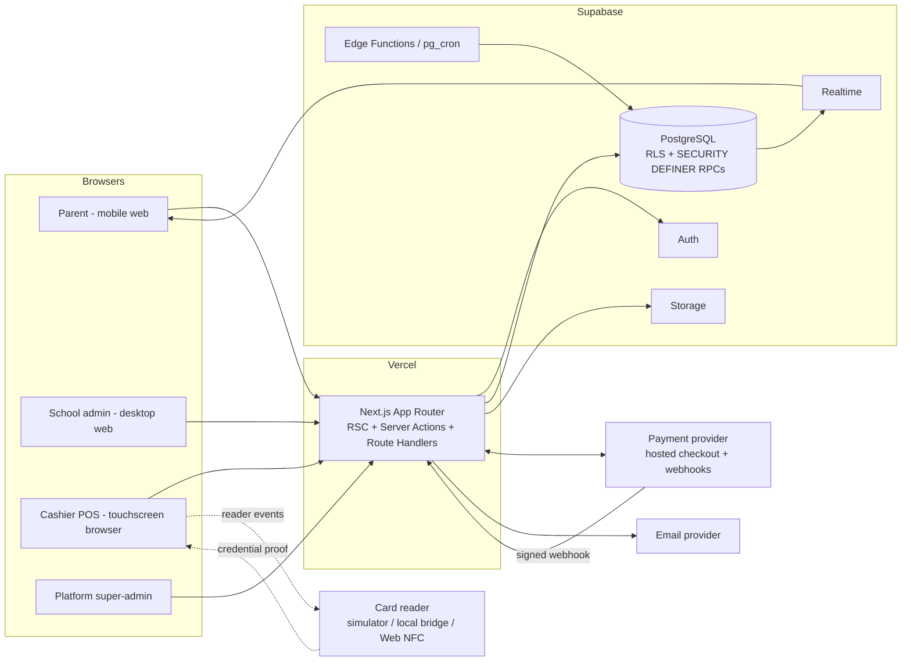

# Architecture

> Status: **Approved 2026-10-25 – Phase 1 complete.** Decisions D-1, D-2, D-3, D-12 resolved (see §15).
> Last updated: 2026-10-25
> Related: [DATABASE_SCHEMA](./DATABASE_SCHEMA.md) · [PAYMENTS_AND_LEDGER](./PAYMENTS_AND_LEDGER.md) · [NFC_INTEGRATION](./NFC_INTEGRATION.md) · [SECURITY](./SECURITY.md) · [IMPLEMENTATION_PLAN](./IMPLEMENTATION_PLAN.md) · [PRODUCTION_READINESS](./PRODUCTION_READINESS.md)

---

## 1. Repository inspection

| Item | Finding |
|---|---|
| Workspace | `/Users/dhru/Desktop/Agency/Northdev/Tuckshop` – **empty**; greenfield build. Nothing to preserve or migrate. |
| Git | Not initialised. Will be initialised in Phase 1 (no remote configured yet). |
| Node / npm | Node v24.14.1, npm 11.11.0. `pnpm` is not installed (decision D-12). |
| Supabase CLI | **Not installed.** |
| Docker | **Not installed** (not needed: hosted dev project chosen, decision D-1). |
| `psql` | Not installed. |

**Consequence (decision D-1 = hosted dev project):** RLS and concurrency tests run against a real PostgreSQL in a dedicated **hosted Supabase dev project**. Because Docker/`supabase test db` is not available, RLS/ledger tests are written in **Vitest + `pg`** with role impersonation (`SET LOCAL ROLE authenticated; SET LOCAL request.jwt.claims = …`) instead of pgTAP. RLS, ledger triggers and row-locking logic cannot be validated with mocks, so no phase involving them is marked complete without passing against real Postgres.

---

## 2. Goals and non-goals

### Goals
- A multi-tenant SaaS for South African primary schools: parents fund learner wallets, learners pay at the tuck shop with an NFC card, schools manage products, stock and reporting, and the platform owner administers schools and subscriptions.
- Pilot with **one school**, scale to hundreds without re-architecture.
- Correctness of money first: integer cents, double-entry ledger, atomic/idempotent operations.
- Tenant isolation enforced **in the database**, not only in the UI.

### Non-goals for v1 (explicitly out of scope)
- **Offline wallet authorisation.** Purchases require a live backend. Needs a separate risk protocol (see §13).
- **Cash handling.** The POS is wallet-only; no cash float, drawer or cash reconciliation.
- **Platform-held pooled funds** (blocked until legal sign-off; see PAYMENTS_AND_LEDGER §2).
- **Sibling-to-sibling wallet transfers**, multi-school wallets, loyalty programmes.
- **SMS/WhatsApp** (the notification design allows them; they are not built).
- **Native mobile apps.** Parent portal is a responsive PWA-capable web app.

---

## 3. System context



---

## 4. Technology stack

| Layer | Choice | Notes |
|---|---|---|
| Framework | Next.js (App Router), React, TypeScript (strict) | Latest stable confirmed at Phase 1. The request interceptor is named `middleware.ts` or `proxy.ts` depending on the Next version; either way it only refreshes the session and does coarse redirects. **It is never the authorisation boundary.** |
| UI | Tailwind CSS, shadcn/ui, Lucide, Recharts | One shared design system / tokens across all four interfaces. |
| Forms / validation | React Hook Form + Zod | Zod schemas in `lib/validations` are shared by client forms and server actions. The server always re-validates. |
| Backend | Supabase (Postgres, Auth, Storage, Realtime) | Via `@supabase/ssr` for cookie sessions. Uses the new publishable / secret API keys. |
| Money | Integer cents (`bigint` in DB, `number` in TS within safe range, `bigint` for aggregates) | Formatting at the edge only. No floats anywhere in finance code. |
| Payments | Provider abstraction; first adapter chosen by decision D-2 | See PAYMENTS_AND_LEDGER §3. |
| Email | Provider behind a `NotificationChannel` interface (proposed: Resend) | Decision D-6. |
| Rate limiting | Upstash Redis via `@upstash/ratelimit` (proposed) with a DB-backed fallback for money endpoints | Decision D-7. |
| Monitoring | Sentry (proposed) + Vercel logs + DB-level health checks | Decision D-8. |
| Testing | Vitest (unit; integration with `pg` for RLS/ledger/concurrency), Playwright (e2e) | |
| Hosting | Vercel (functions pinned to the closest region) + Supabase | Verify Cape Town regions for both (POPIA cross-border consideration, D-10). |

Versions are pinned and recorded in `package.json` at Phase 1. Nothing in this document depends on a specific minor version.

---

## 5. Application structure

One Next.js app, four role-specific interfaces, one backend. Routes are exactly those in the brief.

```
app/
  (public)/            /  (marketing, privacy notice)
  (auth)/              /login /register /forgot-password /reset-password /select-context
  (parent)/parent/…    dashboard, children, wallet, top-up, transactions, spending-controls, notifications, settings
  (pos)/pos/…          pos, transactions, refunds, shift, settings
  (school)/school/…    dashboard, learners, parents, cards, products, inventory, transactions, reports, staff, settings
  (admin)/admin/…      dashboard, schools, users, transactions, payments, analytics, subscriptions, audit-logs, settings
  api/
    webhooks/<provider>/[schoolId]/route.ts   signature-verified, no cookie auth
    cron/…                                    secret-protected scheduled jobs
    pos/…                                     reader-bridge endpoints (if needed)
components/  ui/ (shadcn) · shared/ · parent/ · school/ · pos/ · admin/
lib/
  supabase/       server.ts · browser.ts · admin.ts ("server-only", service role)
  auth/           session, requireContext(), permissions
  payments/       provider interface + adapters
  wallets/        money utils, types
  nfc/            reader abstraction, credential verification
  inventory/ notifications/ validations/ errors/ audit/
services/         wallet-service · payment-service · pos-service · card-service · inventory-service
supabase/         migrations/ · seed.sql · config.toml
tests/            unit/ · integration/ · e2e/
docs/
```

### Layering rule

```
UI (RSC / client components)
   └─► Server Actions / Route Handlers      ← authenticate, authorise, Zod-validate, map errors
          └─► services/*                    ← business orchestration, no UI, no HTTP types
                 └─► Supabase client / RPC  ← user-JWT client (RLS) or service-role client (restricted)
                        └─► PostgreSQL      ← RLS, constraints, SECURITY DEFINER functions (final authority)
```

- UI components never import `lib/supabase/admin.ts` and never compute balances.
- `lib/supabase/admin.ts` is marked `import 'server-only'` and may be imported only from an allow-listed set of modules (enforced by an ESLint `no-restricted-imports` rule and a CI check). Everything in the allow-list is listed in SECURITY §6.
- Business rules that protect money live **in the database function**, not only in TypeScript, so a bug or compromise in the app tier cannot bypass them.

---

## 6. The four interfaces and the shared backend

| Interface | Primary users | Route group | Reads | Writes |
|---|---|---|---|---|
| Parent portal | `parent` | `/parent/*` | RSC with **user-JWT** client; RLS limits to guardian's children | Server Actions → RPC functions (spending limits, freeze card, preferences). Top-up creation → server-side payment service. |
| POS | `cashier` (and `school_admin`) | `/pos/*` | Product catalogue + shift data via user-JWT client under RLS | **Only** through the `pos-service` → `pos_checkout` / `pos_refund_request` RPCs. No direct table writes. |
| School admin | `school_admin` | `/school/*` | User-JWT client under RLS (tenant-scoped) | Catalogue/learner CRUD via RLS-guarded direct writes **with audit triggers**; sensitive actions (card status, adjustments, invitations, staff roles) via RPC. |
| Super-admin | `super_admin` | `/admin/*` | **No blanket tenant-data access.** Platform tables + aggregate views / RPCs that return school-level metrics without learner PII. | Via RPC with MFA (AAL2) enforced and every call audit-logged. |

Cross-cutting rules:
1. **Reads** go through the user's JWT, so RLS applies. Pages never use the service role to read tenant data "for convenience".
2. **Writes affecting money, card state, roles or limits** go through server code → named Postgres functions that independently re-check the actor. The browser can never call those functions directly: `EXECUTE` is revoked from `anon`/`authenticated` and granted to `service_role` only (verified by an automated grants test).
3. The browser never sends a role, school id as an authority, price, balance or "payment succeeded" flag that the server trusts. School ids in URLs/payloads are **hints** that must match the actor's DB-verified assignments.

---

## 7. Authentication and context selection

1. **Login** – Supabase Auth (email + password; email verification required before any role is usable; TOTP MFA supported, mandatory for `super_admin` and `school_admin`, recommended for parents).
2. **Resolve identity** – server loads `role_assignments` for `auth.uid()` where `status = 'active'` and joins `schools.status`.
3. **Resolve contexts** – list of `{role, school_id}`. `parent` is a cross-school context (the children's schools are derived from `parent_learner_relationships`).
4. **Redirect** – one context → straight to its dashboard; several → `/select-context`; none → "no access" page with a clear message (missing membership / disabled).
5. **Active context** – stored in an `httpOnly`, signed, `SameSite=Lax` cookie purely as a **UI preference**. On every request `requireContext({role, schoolId})` re-validates it against the database. Tampering yields a redirect, never elevated access.
6. **Switching** – `/select-context` or the header switcher POSTs a Server Action that re-verifies the target context before re-issuing the cookie.
7. **Roles are not placed in the JWT.** Role changes (e.g. disabling a cashier) take effect on the next request, not at token expiry. RLS helper functions read `role_assignments` directly (cached per statement with the `(select …)` initplan pattern).

Failure modes handled with distinct, user-safe messages: invalid credentials, unverified email, expired session, disabled account, no school membership, suspended school, MFA required.

---

## 8. Multi-tenancy

- **Model:** shared database, shared schema, `school_id` on every school-owned row.
- **Enforcement:** RLS policies on every table (default deny). Policies use `private.*` helper functions (`SECURITY DEFINER`, `search_path = ''`).
- **Integrity:** composite foreign keys such as `(school_id, learner_id)` reference `(school_id, id)` so a row can never point to a learner/product/wallet in a *different* school even via the service role or a bug. This is a structural guard, not just a policy.
- **Per-tenant configuration:** `school_settings` (limits, custody model, provider, timezone, retention, feature flags).
- **Per-tenant secrets:** payment credentials stored encrypted in a service-role-only table (see PAYMENTS_AND_LEDGER §2).
- **Lifecycle:** `pending → active → suspended → deactivated`. Suspended schools cannot complete purchases or accept top-ups (enforced inside the DB functions). Historical records are retained and readable by authorised staff and the platform.
- **Platform support access:** super-admin has no ambient tenant-data access. A time-boxed, school-approved, audited *support grant* mechanism is proposed for troubleshooting (Phase 10; see SECURITY §5).

---

## 9. Money, wallet and ledger (summary)

Full detail: [PAYMENTS_AND_LEDGER](./PAYMENTS_AND_LEDGER.md).

- Per-learner `wallets` with a **cached** `balance_cents` that is only changed inside ledger-posting functions and protected by `CHECK (balance_cents >= 0)`.
- Immutable, double-entry `ledger_transactions` / `ledger_entries`; a deferred constraint trigger guarantees `Σ debits = Σ credits` per transaction; update/delete is blocked by trigger and privilege revocation.
- All money functions are idempotent (unique idempotency keys) and lock rows in a fixed order to avoid deadlocks.
- A wallet balance is a **record of entitlement**, distinct from where the cash physically sits. The custody model is configurable per school and defaults to *school-owned merchant account; platform never holds funds*.

---

## 10. Key flows (pointers)

| Flow | Where specified |
|---|---|
| Parent invitation and learner linking | DATABASE_SCHEMA §5, SECURITY §8 |
| Top-up (pending → hosted checkout → verified webhook → credit once) | PAYMENTS_AND_LEDGER §7 |
| POS checkout (tap → preview → confirm → atomic commit) | PAYMENTS_AND_LEDGER §6 |
| Card issue / freeze / replace | NFC_INTEGRATION §6 |
| Refunds, adjustments, reconciliation | PAYMENTS_AND_LEDGER §4.4, §9 |

---

## 11. Realtime

Supabase Realtime is used only where it improves UX and RLS applies to the channel:
- Parent dashboard: wallet balance / new transaction / notification badge (subscribes to rows RLS already exposes to that guardian).
- POS: product availability / low-stock hints (best effort; the database remains the authority at checkout).
- Admin: not required initially.

Realtime is **never** the source of truth for a financial outcome; the POS shows success only after the RPC returns.

---

## 12. Background jobs

| Job | Mechanism | Purpose |
|---|---|---|
| Notification dispatch | `notification_deliveries` outbox + Vercel Cron / Edge Function | Send email, retry with backoff. |
| Pending top-up recovery | Cron | Query provider for top-ups pending past a threshold; resolve missed webhooks; expire abandoned ones. |
| Wallet ↔ ledger reconciliation | Cron (nightly + on-demand) | Recompute balances from ledger; write `reconciliation_records`; alert on variance ≠ 0. |
| Low-balance evaluation | Triggered after balance-changing commit (outbox row) | Create low-balance notification (de-duplicated). |
| Invitation / session housekeeping | Cron | Expire invitations and pending top-ups. |
| Subscription billing run | Cron (Phase 10) | Generate `subscription_invoices` from configurable plan rules. |

All cron endpoints require a shared secret and are idempotent.

---

## 13. Network connectivity posture

- Online-only for wallet authorisation. The POS shows a persistent connection indicator; if offline, **Checkout is disabled** and the basket is preserved in memory/session storage (no balances or card data stored).
- Each checkout attempt carries a client-generated **idempotency key** (UUID) created when the cashier presses Checkout and reused on retry. Double-taps and retries cannot double-charge.
- If the response is lost, the POS enters an explicit **"Outcome unknown"** state and queries `pos_get_purchase_status(idempotency_key)` before allowing a new attempt. It never displays success until the server confirms, and never presents a pending/unknown state as a success.
- Offline authorisation would require a separate design (per-card offline limits, signed offline vouchers, risk caps, later sync/reconciliation, loss ownership). Explicitly deferred.

---

## 14. Error handling and observability

- Typed domain errors (`InsufficientFundsError`, `CardFrozenError`, …) with stable codes and user-safe messages. Database `RAISE EXCEPTION` uses structured SQLSTATE/codes mapped in one place (`lib/errors`). Raw DB errors and stack traces never reach the client.
- Server logging is structured JSON with a request id; no secrets, no card credentials, no payment payloads, minimal personal data.
- Sentry (or equivalent) with PII scrubbing. Alerts on: ledger imbalance, non-zero reconciliation variance, webhook signature failures spike, stuck pending top-ups, checkout error rate, cron failures.
- Every screen defines loading, empty, error and success states.

---

## 15. Technical decisions

### Decided in this proposal (override if you disagree)

| # | Decision | Rationale |
|---|---|---|
| A-1 | Single Next.js app with route groups per interface | Shared design system/backend; simpler ops for a small team. |
| A-2 | Roles stored in `role_assignments`, not in JWT claims | Immediate revocation; no stale privilege. |
| A-3 | `school_memberships` merged into `role_assignments` (scope + permissions + status) | Avoids two sources of truth for "who can act where". |
| A-4 | Money-moving functions executable only by `service_role`, but each re-verifies the acting user in SQL | Allows the server to verify card cryptography and provider signatures before calling the DB, while the DB still enforces authorisation. |
| A-5 | Composite `(school_id, id)` FKs for tenant integrity | Structural cross-tenant protection. |
| A-6 | Products/learners/etc. use direct RLS-guarded CRUD; ledger/wallet/card-status/role changes use RPC only | Lower boilerplate where risk is low, strict control where it is high. |
| A-7 | Failed checkouts are *not* purchases; they are recorded in `purchase_attempts` | Keeps `purchases` = confirmed sales. |
| A-8 | Wallet is per learner (per school) | Matches the brief; siblings have separate wallets and limits. |
| A-9 | Timezone-aware school day (`Africa/Johannesburg` default, per-school setting) for spending limits and reports | Avoids UTC-boundary bugs. |
| A-11 | **Cache Components disabled** (`cacheComponents: false`), `proxy.ts` instead of middleware | Every page is per-user and dynamic; opt-in caching around financial/personal data adds risk and no benefit. Revisit when it becomes the only mode. |
| A-10 | Free-text learner DOB and national ID are **not collected**; grade and a school-assigned admission reference only | POPIA data minimisation. |

### Resolved by you on 2026-10-25

| # | Decision |
|---|---|
| D-1 | Hosted Supabase **dev project**; no local Docker. DB tests use Vitest + `pg`. |
| D-2 | **PayFast** is the first payment provider (Yoco later as a second adapter). |
| D-3 | **School-owned merchant account** per school; the platform never holds funds. |
| D-12 | **npm**. |

### Open (need your decision) – see also IMPLEMENTATION_PLAN §6

| # | Decision | Recommended default |
|---|---|---|
| D-4 | NFC credential strategy for pilot | NTAG 424 DNA (secure dynamic messaging) with per-card diversified keys; simulator in dev. |
| D-5 | Card encoding/personalisation | Source pre-encoded cards from a vendor, or build an internal encoding tool. |
| D-6 | Email provider | Resend (or your existing provider). |
| D-7 | Rate limiting store | Upstash Redis. |
| D-8 | Error monitoring | Sentry. |
| D-9 | Pilot school details (payments setup, grade structure, break times, existing tuck-shop products, hardware) | Needed before Phase 3 seed data, Phase 7/8 hardware. |
| D-10 | Hosting regions | Supabase `af-south-1` and Vercel Cape Town if available on your plans (verify). |
| D-11 | Legal: custody, POPIA roles, DPA, privacy notice, refund-of-unspent-balance policy | Engage a South African attorney in parallel (long lead-time). |

---

## 16. External dependencies and risk areas

### Financial
- Who legally holds prepaid funds (school vs platform vs payment provider) and whether the arrangement triggers payment-system / deposit-taking / consumer-protection obligations. **Requires legal advice; not assumed.**
- Each school's merchant account onboarding (KYC, settlement bank account) with the chosen provider.
- Policy for unspent balances when a learner leaves, refunds to parents, chargebacks and failed settlements.
- Provider fees: who bears them; how they are shown (top-up vs sales vs platform revenue).

### NFC hardware
- Card technology that supports cryptographic authentication; compatible readers; a way to bridge readers to the browser (see NFC_INTEGRATION). UID-only payments are disabled in production by default.
- Hardware procurement lead time and a physical test with real cards/readers before any production claim.

### Security
- Key custody for NFC diversification master keys and payment-credential encryption (KMS / Vault).
- MFA rollout, incident response contacts, penetration test before launch.

### Regulatory
- POPIA: school = responsible party, platform = operator (to be confirmed by counsel); special protection for children's information; operator agreement; breach notification; cross-border transfers; retention. See SECURITY §10 and PRODUCTION_READINESS §6.
- Consumer-protection and e-commerce disclosures (pricing, refunds, terms), tax treatment of subscription revenue vs wallet funds.

**No document or UI in this project will claim legal compliance based on technical controls alone.**
