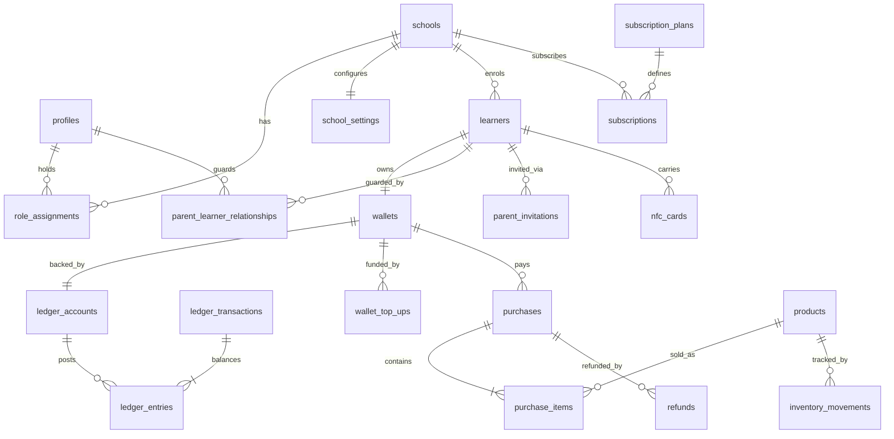

# Database Schema

> Status: **Proposed – awaiting approval (pre-Phase 1)**
> Target: PostgreSQL on Supabase. Migrations are plain SQL files in `supabase/migrations/` (timestamped, forward-only, reviewed). Seed data in `supabase/seed.sql` is clearly labelled as demonstration data.

---

## 1. Conventions

| Topic | Convention |
|---|---|
| Primary keys | `uuid` default `gen_random_uuid()` |
| Tenant column | `school_id uuid not null` on every school-owned table |
| Tenant integrity | Every school-owned table has `unique (school_id, id)`; child tables use **composite FKs** `(school_id, parent_id) → parent (school_id, id)` so cross-school references are structurally impossible |
| Money | `bigint` **cents** (`*_cents`), `currency char(3) default 'ZAR' check (currency = 'ZAR')`. No `numeric`/`float` for money |
| Timestamps | `timestamptz`; `created_at default now()`, `updated_at` via trigger. School-day logic uses `schools`' timezone, never server local time |
| Enums | Postgres `enum` types for stable sets (status machines); `text + CHECK` where values are expected to evolve |
| Deletion | Financial and audit tables: **no DELETE/UPDATE**, no cascading deletes. Other tables use `status`/`archived_at` soft states. FKs from financial tables are `ON DELETE RESTRICT` |
| Schemas | `public` (tables exposed to PostgREST, all with RLS), `private` (helper functions; not exposed), `extensions` |
| Defaults | `ALTER DEFAULT PRIVILEGES` revokes `EXECUTE` from `PUBLIC`; each function's grants are explicit and tested |
| RLS | Enabled and **forced** on every table in `public`. No table is readable without a policy |
| Naming | `snake_case`, plural tables, `*_id` FKs, `*_cents`, `*_at` |

### Write-path legend
- **RLS** – direct PostgREST write by `authenticated`, restricted by RLS + CHECK constraints, audit trigger attached.
- **RPC** – only through a named SQL function (callable by `service_role`; the function re-verifies the actor).
- **SYS** – written only by triggers / jobs / webhooks, never by user-facing code.

---

## 2. Entity overview

---

## 3. Identity and tenancy

### `profiles` — RLS (own row, limited columns) / RPC
| Column | Type | Notes |
|---|---|---|
| id | uuid PK | = `auth.users.id` (FK, on delete restrict) |
| first_name, last_name | text not null | |
| email | citext not null unique | mirrors verified auth email; synced by trigger |
| phone | text | E.164 check |
| status | enum `active, disabled` | disabled blocks all contexts |
| privacy_notice_version | text | last notice acknowledged |
| created_at, updated_at | timestamptz | |

A trigger creates the profile on `auth.users` insert. A user may update only name/phone; `status`/`email` are protected by column privileges and trigger.

### `schools` — RPC (super_admin / onboarding) ; school_admin updates limited columns via RLS
| Column | Notes |
|---|---|
| id, name, school_code (unique, immutable), address, province (enum of 9 provinces), contact_email, contact_phone, logo_url | per brief |
| status | enum `pending, active, suspended, deactivated`; `status_reason`, `status_changed_at/by` |
| subscription_plan_id | FK → subscription_plans (convenience; `subscriptions` is authoritative) |
| timezone | default `Africa/Johannesburg` |
| created_at, updated_at | |

Transitions are restricted to a SQL function `set_school_status()` (super_admin only, audited, reason mandatory).

### `role_assignments` — RPC
Merges the brief's `school_memberships` and `role_assignments` (single source of truth for "who may act where").

| Column | Notes |
|---|---|
| id | |
| user_id | FK profiles |
| role | enum `parent, cashier, school_admin, super_admin` |
| school_id | FK schools; **null** for `parent` and `super_admin`; **required** for `cashier`, `school_admin` (CHECK) |
| permissions | `text[]` – fine-grained staff permissions, e.g. `pos.refund.request`, `pos.override`, `inventory.adjust`, `reports.view` (validated against an allow-list) |
| status | enum `invited, active, disabled` |
| granted_by, created_at, updated_at, disabled_at | |

Unique: `(user_id, role, coalesce(school_id, '00000000-…'))`. A user can hold many rows (admin + parent, or cashier at two schools).
`parent` is granted automatically at registration; it carries no data access by itself — access derives from `parent_learner_relationships`.

### `staff_invitations` — RPC
`school_id, email, role (cashier|school_admin), permissions, token_hash (sha256, unique), expires_at, status, invited_by, accepted_by, accepted_at`. Token shown once; only the hash is stored.

### `school_settings` — RLS (school_admin, selected columns) / RPC (platform-controlled columns)
| Column | Notes |
|---|---|
| school_id PK | |
| topup_min_cents, topup_max_cents, topup_presets_cents int[] | defaults 5000/50000+; presets R50/R100/R200/R500 |
| low_balance_default_cents | default threshold for notifications |
| custody_model | enum `school_merchant`, `platform_pooled`, `provider_split` — `platform_pooled` cannot be set without a recorded legal-approval flag |
| payment_provider | enum nullable (`payfast`, `yoco`, …) |
| payments_enabled | boolean default **false** (live money requires explicit enablement) |
| allow_uid_only_cards | boolean default **false** (dev/test only) |
| allow_simulated_cards | boolean default **false**; hard-blocked when `platform_settings.environment = 'production'` |
| product_restrictions_enabled | boolean |
| require_open_shift | boolean default true |
| refund_approval_threshold_cents | refunds above need school_admin approval |
| retention_months_* | configurable retention (see SECURITY §10) |

### `school_payment_credentials` — **SYS/service-role only, no RLS select for anyone**
`school_id, provider, encrypted_payload (envelope-encrypted), key_version, status, rotated_at`. Never selectable via PostgREST roles; accessed by `lib/supabase/admin.ts` in payment modules only.

### `platform_settings` — RPC (super_admin)
`key text PK, value jsonb, updated_by, updated_at`. Includes `environment`, feature flags, global limits.

---

## 4. Privacy and compliance tables

| Table | Purpose | Write |
|---|---|---|
| `legal_documents` | Versioned privacy notice, terms, DPA template (`kind, version, content_ref, effective_from`) | RPC (super_admin) |
| `school_agreements` | Record of each school's accepted operator/DPA version (`school_id, document_id, accepted_by, accepted_at`) | RPC |
| `consent_records` | Guardian acknowledgements / consents with purpose and notice version (`user_id, school_id, learner_id, purpose, notice_version, granted_at, withdrawn_at`) | RPC |
| `data_subject_requests` | Access / correction / deletion / objection requests and their workflow (`requester_id, school_id, learner_id, type, status, due_at, resolved_at, notes`) | RPC |
| `incident_reports` | Security incident register for breach-notification workflow (`severity, detected_at, contained_at, notified_regulator_at, notified_subjects_at, summary, created_by`) | RPC (super_admin) |

---

## 5. Learners and guardians

### `learners` — RLS (school_admin)
`id, school_id, first_name, last_name, grade (text, validated against school's grade list), class_name, admission_ref (school's own reference; unique per school), status (enum `active, inactive, left`), deactivated_at, anonymised_at, created_by, created_at, updated_at`.
No date of birth, ID number, address or photo is stored (data minimisation). Cashiers get only `first_name`, last initial and grade via the checkout RPC result, not table access.

### `parent_invitations` — RPC
| Column | Notes |
|---|---|
| id, school_id, learner_id | composite FK to learners |
| invited_email | optional but recommended; when set, acceptance requires the *verified* auth email to match |
| relationship_type | enum `mother, father, guardian, other` |
| can_top_up, can_manage_controls | proposed permissions for the resulting relationship |
| token_hash | sha256 of a ≥128-bit random token; unique; token never stored |
| expires_at | default now() + 7 days; configurable |
| status | enum `pending, accepted, expired, revoked` |
| failed_attempts | locks after N wrong tries |
| created_by, accepted_by, accepted_at | |

### `parent_learner_relationships` — RPC
`id, school_id, learner_id, parent_id, relationship_type, status (enum pending_approval, active, revoked), can_top_up, can_manage_controls, approved_by, approved_at, revoked_by, revoked_at, created_at`. Unique `(learner_id, parent_id)`.

**Linking flow:** school creates learner → school generates invitation → parent registers/logs in (email verified) → `accept_parent_invitation(token)`:
- invitation valid, unexpired, unused, learner active, school active;
- if `invited_email` set and matches verified email → relationship `active`;
- otherwise (no email lock, or additional guardian) → `pending_approval` until a school admin approves;
- attempts are rate-limited and logged; guessing a learner name achieves nothing because there is no name-based lookup path anywhere.

---

## 6. NFC cards

### `nfc_cards` — RPC
| Column | Notes |
|---|---|
| id, school_id | |
| learner_id | nullable until assigned |
| credential_scheme | enum `simulated, uid_only, ntag424_sdm, desfire_ev3` |
| credential_reference | **non-reversible** reference: `HMAC-SHA256(server_pepper, raw identifier)` – a DB leak does not expose raw UIDs. Globally unique |
| key_version | which master/diversification key generation was used |
| last_read_counter | bigint – monotonic SDM read counter for replay protection |
| card_number | short human-readable label printed on the card (for support) |
| card_status | enum `unassigned, active, frozen, lost, stolen, replaced, deactivated` |
| status_reason | text |
| replaced_by_card_id | self-FK |
| issued_at, activated_at, deactivated_at, expires_at, last_used_at | |

Constraints: partial unique index → **at most one `active` card per learner**; CHECK that `active/frozen` cards have a learner; CHECK `credential_scheme='simulated'` rows are only creatable when `allow_simulated_cards` is true and environment ≠ production (trigger).

### `card_events` — SYS (append-only)
`id, school_id, card_id (nullable for unknown credentials), event_type (issued, assigned, activated, frozen, unfrozen, lost, stolen, replaced, deactivated, read_ok, read_rejected, replay_detected), from_status, to_status, actor_id, reader_device_id, reason, metadata, created_at`.

### `card_reader_devices` — RLS (school_admin)
`id, school_id, name, reader_type (simulated, web_nfc, pcsc_bridge, keyboard_wedge, serial), device_identifier, status, last_seen_at, registered_by`.

---

## 7. Wallets and ledger (finance core)

> Detail and invariants: [PAYMENTS_AND_LEDGER](./PAYMENTS_AND_LEDGER.md). **No user-facing role has INSERT/UPDATE/DELETE on any table in this section.**

### `wallets` — SYS/RPC
`id, school_id, learner_id (unique), status (active, frozen, closed), balance_cents bigint not null default 0 CHECK (>= 0), ledger_account_id (unique FK), created_at, updated_at`.
Created in the same transaction as the learner. `balance_cents` is a **projection** of the ledger, updated only inside ledger-posting functions; a nightly job and an integration test verifies `balance_cents = Σ(credits − debits)` of its ledger account.

### `ledger_accounts` — SYS
| Column | Notes |
|---|---|
| id, school_id (nullable for platform-level accounts) | |
| account_type | enum `wallet_liability, provider_clearing, settled_funds, school_sales, provider_fees, adjustments, suspense, platform_fees` (semantics in PAYMENTS_AND_LEDGER §4.1) |
| wallet_id | non-null only for `wallet_liability` (unique) |
| normal_side | `debit` or `credit` |
| name, currency | |

Exactly one account per `(school_id, account_type)` for non-wallet types (partial unique index).

### `ledger_transactions` — SYS (append-only)
`id, school_id, transaction_type (top_up, purchase, purchase_refund, top_up_reversal, adjustment, fee, settlement, reversal), idempotency_key, reference_type, reference_id, reverses_transaction_id, description, effective_at, created_by, created_at, metadata`.
Unique `(school_id, idempotency_key)`; unique `(reverses_transaction_id)` where not null (a transaction can be reversed at most once).

### `ledger_entries` — SYS (append-only)
`id, ledger_transaction_id (RESTRICT), school_id, account_id (RESTRICT), direction (debit|credit), amount_cents bigint CHECK (> 0), created_at`.
- Deferred **constraint trigger**: at commit, `Σ debit = Σ credit` per ledger transaction.
- `BEFORE UPDATE OR DELETE` triggers raise; `REVOKE UPDATE, DELETE, TRUNCATE` from all non-owner roles.

### `wallet_top_ups` — SYS/RPC
`id, school_id, wallet_id, learner_id, parent_id, amount_cents CHECK(>0), currency, status (pending, redirected, succeeded, failed, cancelled, expired, reversed), source (manual, auto), provider, provider_checkout_ref, provider_payment_id, provider_fee_cents, expires_at, failure_code, ledger_transaction_id, idempotency_key, created_at, updated_at`.
Unique `(provider, provider_payment_id)` and `(school_id, idempotency_key)`. Amount bounds validated against `school_settings` in the creating function.

### `payment_provider_events` — SYS (append-only)
`id, provider, provider_event_id, school_id, event_type, signature_valid, raw_payload (jsonb, credential-scrubbed), received_at, processed_at, processing_status (received, processed, ignored_duplicate, rejected, error), error_code, top_up_id, refund_id`. Unique `(provider, provider_event_id)` — the idempotency anchor for webhook replay.

### `auto_top_up_settings` — *Phase 11, conditional on provider tokenisation support*
`id, school_id, wallet_id, parent_id, enabled, threshold_cents, amount_cents, monthly_cap_cents, max_failures, failure_count, provider_token_ref (encrypted), consent_record_id, last_triggered_at, status`. Created only if the chosen provider's recurring/tokenisation capability is verified and enabled on the merchant account.

### `purchases` — SYS (via `pos_checkout`)
`id, school_id, receipt_number (per-school sequence), wallet_id, learner_id, card_id, cashier_id, shift_id, pos_device_id, reader_device_id, status (completed, partially_refunded, refunded), total_cents CHECK(>0), wallet_balance_after_cents, idempotency_key, request_hash, ledger_transaction_id, override_id, created_at`.
Unique `(school_id, idempotency_key)`; `request_hash` ensures the same key cannot be re-used with a different basket.

### `purchase_items` — SYS
`id, school_id, purchase_id, product_id, product_name, category_name, unit_price_cents, cost_price_cents, quantity CHECK(>0), line_total_cents (= unit×qty, CHECK), refunded_quantity default 0 CHECK (<= quantity)`. Names/prices are **snapshots** so history survives product edits.

### `purchase_attempts` — SYS (append-only)
`id, school_id, idempotency_key, outcome (declined, error, timeout_unknown), failure_code, card_id, learner_id, cashier_id, pos_device_id, total_cents, created_at`. Supports decline analytics, fraud review and "outcome unknown" resolution. Never affects balances.

### `purchase_overrides` — RPC
`id, school_id, cashier_id, authorised_by, override_type (spending_limit, product_restriction, other), reason, created_at`. Every override also writes an audit row.

### `refunds` / `refund_items` — RPC
`refunds`: `id, school_id, purchase_id, wallet_id, requested_by, approved_by, status (requested, approved, rejected, completed), amount_cents, reason, restock boolean, idempotency_key, ledger_transaction_id, created_at, completed_at`.
`refund_items`: `refund_id, purchase_item_id, quantity, amount_cents`.
Function-level lock on the purchase ensures `Σ refunded ≤ purchase total` and no double refund.

### `payment_refunds` — RPC (Phase 9)
Provider-side refunds of top-ups (money back to the parent's card): `id, school_id, top_up_id, amount_cents, status, provider_refund_ref, requested_by, approved_by, ledger_transaction_id`. Only possible up to the unspent balance (see PAYMENTS_AND_LEDGER §9).

### `wallet_adjustments` — RPC
`id, school_id, wallet_id, direction, amount_cents, reason_code, notes, requested_by, approved_by (dual control above threshold), ledger_transaction_id, created_at`.

### `reconciliation_records` — SYS/RPC
`id, school_id, run_type (wallet_vs_ledger, ledger_balance, provider_vs_topups, settlement), period_start/end, expected_cents, actual_cents, variance_cents, status (ok, variance, resolved), details jsonb, run_by, resolved_by, resolved_at, created_at`.

### `provider_settlements` — SYS (imported)
`id, school_id, provider, provider_reference, gross_cents, fee_cents, net_cents, settled_at, imported_at`. Lets reports separate *top-ups received*, *funds actually settled* and *sales*.

---

## 8. POS and inventory

| Table | Key columns | Write |
|---|---|---|
| `product_categories` | `school_id, name (unique per school, case-insensitive), sort_order, colour, is_active`. Seeded defaults: Food, Snacks, Drinks, Stationery, Other | RLS |
| `products` | `id, school_id, category_id, name, description, barcode, price_cents CHECK(>=0), cost_price_cents, image_path, track_stock, stock_quantity, low_stock_threshold, is_active, archived_at, created_at, updated_at`. Unique `(school_id, barcode)` where barcode not null and not archived; CHECK `track_stock ⇒ stock_quantity >= 0` | RLS (school_admin; price/stock-changing columns audited) |
| `inventory_movements` | `id, school_id, product_id, movement_type (initial, sale, refund_return, restock, adjustment, write_off), quantity_delta, quantity_after, unit_cost_cents, supplier, reference_type, reference_id, actor_id, reason, created_at` — append-only | SYS |
| `stock_adjustments` | `id, school_id, product_id, quantity_delta, reason_code, notes, adjusted_by, inventory_movement_id` | RPC |
| `pos_devices` | `id, school_id, name, status, registered_by, last_seen_at` | RLS (school_admin) |
| `cashier_shifts` | `id, school_id, cashier_id, pos_device_id, opened_at, closed_at, status (open, closed), sales_count, sales_total_cents, notes` — totals frozen at close | RPC |

`products.stock_quantity` is a projection of `inventory_movements`; changed only in the same transaction as the movement row.

---

## 9. Spending controls

| Table | Columns | Write |
|---|---|---|
| `spending_limits` | `school_id, learner_id (unique), daily_limit_cents (null = none), weekly_limit_cents, updated_by, updated_at` | RPC (guardian with `can_manage_controls`; changes audited) |
| `product_restrictions` | `id, school_id, learner_id (null = school-wide rule), scope (category|product), category_id, product_id, rule (blocked|allowed_weekdays), allowed_weekdays int[], set_by_role (parent|school), is_active` | RPC |

Enforcement is inside `pos_checkout` (never in the UI). Day/week windows computed in the school's timezone.

---

## 10. Notifications

| Table | Columns |
|---|---|
| `notifications` | `id, user_id, school_id, learner_id, category (topup_succeeded, topup_failed, low_balance, card_frozen, card_replaced, auto_topup_failed, refund_completed, purchase, system), title, body, data jsonb, is_essential, read_at, created_at` — body templates avoid sensitive detail |
| `notification_deliveries` | `id, notification_id, channel (in_app, email, sms, whatsapp), status (pending, sent, failed, skipped), attempts, next_attempt_at, provider_message_id, last_error` — the outbox |
| `notification_preferences` | `user_id, learner_id (nullable), category, channel, enabled, threshold_cents`. Essential categories (card_frozen, card_replaced, security, failed top-up/auto top-up) cannot be disabled — enforced in the setter function |

---

## 11. SaaS administration

| Table | Columns |
|---|---|
| `subscription_plans` | `id, code, name, pricing_model (flat, per_learner, tiered, transaction_fee, hybrid), billing_interval, config jsonb (base_cents, per_learner_cents, tiers[], fee_bps, fee_fixed_cents), is_active` — **no hard-coded prices** |
| `subscriptions` | `id, school_id, plan_id, status (trialing, active, past_due, cancelled), current_period_start/end, price_snapshot jsonb, started_at, cancelled_at` |
| `subscription_invoices` | `id, subscription_id, school_id, period_start/end, learner_count, platform_fee_basis_cents, amount_cents, status (draft, issued, paid, void)` — platform revenue, entirely separate from wallet funds |
| `support_access_grants` *(Phase 10 proposal)* | `id, school_id, granted_by (school_admin), granted_to (super_admin), scope, expires_at, revoked_at` |
| `audit_logs` | `id, occurred_at, actor_id, actor_role, school_id, action, entity_type, entity_id, outcome (success|denied|error), metadata jsonb, request_id, ip_hash, prev_hash/row_hash (optional tamper-evidence chain)` — append-only |

---

## 12. Core functions (all `SECURITY DEFINER`, `set search_path = ''`)

| Function | Callable by | Purpose |
|---|---|---|
| `private.has_role(role, school_id)` / `private.is_staff(school_id, roles[])` / `private.has_permission(school_id, perm)` / `private.is_guardian_of(learner_id)` | RLS only | Authorisation helpers |
| `register_school(...)`, `set_school_status(...)` | service_role (super_admin verified inside) | Tenant lifecycle |
| `create_learner(...)` | service_role / RLS | Creates learner + wallet + ledger account atomically |
| `create_parent_invitation`, `accept_parent_invitation`, `approve_guardian`, `revoke_guardian` | service_role | Linking workflow |
| `register_card`, `assign_card`, `set_card_status`, `replace_card` | service_role | Card lifecycle (audited) |
| `pos_preview_checkout(...)` | service_role | Non-binding read-only validation after a tap |
| `pos_checkout(...)` | service_role | **Atomic purchase** |
| `pos_get_purchase_status(key)` | service_role | Resolve "outcome unknown" |
| `request_refund`, `approve_refund`, `complete_refund` | service_role | Purchase refunds |
| `create_top_up(...)`, `apply_top_up_payment(...)`, `fail_top_up(...)`, `expire_top_ups()` | service_role | Top-up lifecycle (credit exactly once) |
| `post_wallet_adjustment(...)` | service_role | Dual-controlled adjustment |
| `adjust_stock(...)` | service_role/RLS | Stock changes with movement |
| `set_spending_limits(...)`, `set_product_restriction(...)` | service_role | Parent controls (audited) |
| `run_reconciliation(...)` | service_role | Wallet-vs-ledger checks |
| `admin_platform_metrics()` etc. | service_role | Aggregate metrics for super-admin without PII |

An integration test (Vitest + `pg`) enumerates every function in `public` and asserts its grant list equals the documented one.

---

## 13. RLS policy matrix (summary)

`✔` = allowed under policy; `—` = denied; "own" = own rows; "G" = learners the user is an *active guardian* of; "S" = the user's school(s) via an active staff assignment and school not deactivated.

| Table | anon | parent | cashier | school_admin | super_admin |
|---|---|---|---|---|---|
| profiles | — | own | own | own + staff of S (name/email) | own (platform user list via RPC) |
| schools | — | schools of G (name only) | S | S (limited update) | all |
| role_assignments | — | own | own | S (read) | via RPC |
| learners | — | G | — (checkout RPC result only) | S | aggregate counts only |
| parent_learner_relationships | — | own | — | S | — |
| wallets | — | G (read) | — | S (read) | aggregates only |
| ledger_* | — | — (parents see `purchases`/`wallet_top_ups`, not raw ledger) | — | S (read) | aggregates only |
| wallet_top_ups | — | own (as payer) | — | S (read) | metadata, no learner identity |
| purchases / purchase_items | — | G (read) | own cashier rows (read) | S (read) | aggregates |
| nfc_cards | — | G (status only) | — | S | — |
| products / categories | — | — | S (read active) | S (CRUD) | — |
| inventory_movements | — | — | — | S (read) | — |
| spending_limits | — | G (read) | S (enforced in RPC only) | S (read) | — |
| notifications / preferences | — | own | own | own | own |
| subscription_* | — | — | — | own school (read) | all |
| audit_logs | — | — | — | S (read, limited) | all (read) |
| payment_provider_events / reconciliation / settlements | — | — | — | S (read, redacted) | metadata |
| school_payment_credentials | — | — | — | — | — (service-role only) |

All write paths are RPC/SYS unless marked RLS in the table sections above.

---

## 14. Indexing plan (initial)

- Every FK column; every `school_id`-leading composite for the frequent queries below.
- `purchases (school_id, created_at desc)`, `(wallet_id, created_at desc)`, `(cashier_id, created_at desc)`, `(school_id, idempotency_key)` unique.
- `purchase_items (purchase_id)`, `(school_id, product_id, created_at)` for product reports.
- `ledger_entries (account_id, created_at)`, `(ledger_transaction_id)`.
- `wallet_top_ups (wallet_id, created_at desc)`, `(status, expires_at) where status in ('pending','redirected')`, unique `(provider, provider_payment_id)`.
- `payment_provider_events` unique `(provider, provider_event_id)`; `(processing_status, received_at)`.
- `nfc_cards` unique `(credential_reference)`; partial unique `(learner_id) where card_status='active'`; `(school_id, card_status)`.
- `products` unique partial `(school_id, barcode)`; `(school_id, category_id) where is_active`; trigram index on `name` for POS search.
- `parent_learner_relationships (parent_id) where status='active'`, `(learner_id)`.
- `notifications (user_id, created_at desc) where read_at is null`; `notification_deliveries (status, next_attempt_at)`.
- `audit_logs (school_id, occurred_at desc)`, `(actor_id, occurred_at desc)`, `(entity_type, entity_id)`.
- Reporting uses SQL views (`v_school_daily_sales`, …) first; materialised views / rollup tables only if measurements justify (Phase 10/12).

---

## 15. Triggers and invariants enforced in the database

1. Ledger append-only (update/delete/truncate blocked).
2. Ledger balanced per transaction (deferred constraint trigger).
3. `wallets.balance_cents >= 0` (CHECK) and only mutated by ledger functions (column privilege + trigger verifying a ledger entry exists in the same transaction).
4. `products.stock_quantity` changes require an `inventory_movements` row in the same transaction.
5. Card status transitions follow the allowed state machine; every change writes `card_events` + audit.
6. School status gate: purchase/top-up functions raise if school ≠ `active`.
7. Audit tables are append-only; `audit_logs` writes are SYS only.
8. `updated_at` maintenance; profile creation on signup; email sync.

---

## 16. Migration plan

| Migration group | Contents | Phase |
|---|---|---|
| 0001 extensions, enums, helpers | `pgcrypto`, `citext`, `pg_trgm`; enums; `private` schema; default-privilege hardening | 2 |
| 0002 identity & tenancy | profiles, schools, role_assignments, settings, invitations | 2 |
| 0003 learners & guardians | learners, relationships, invitations | 2/3 |
| 0004 ledger core (schema + triggers only) | wallets, ledger_*, immutability + balance triggers | 2 |
| 0005 cards, products, inventory, POS, controls, notifications, SaaS, audit, privacy | tables, indexes | 2 |
| 0006 RLS policies + grants | Policies for all tables; function grants | 2 |
| 0007+ | RPC functions per phase (3: onboarding/linking; 5: ledger; 6: inventory; 7: checkout; 8: cards; 9: top-ups; 10: metrics) | 3–10 |

Seeds: `seed.sql` creates the demonstration school, 1 admin, 1 cashier, 2 parents, 3 learners, products, simulated cards, wallets and sample transactions **by calling the real ledger functions** (so seeded balances are ledger-backed, never hard-coded). Every seeded row is tagged `[DEMO]` / flagged in metadata. Seeds refuse to run when `platform_settings.environment = 'production'`.
