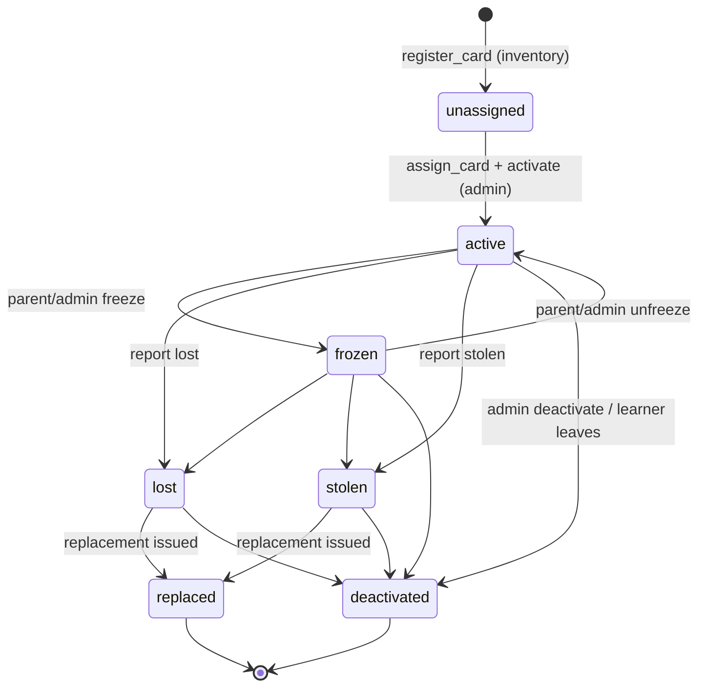

# NFC Integration Strategy

> Status: **Proposed – awaiting approval (pre-Phase 1)**
> **Verification note:** The card-technology details below come from general knowledge of NXP product families and standards, **not** from a datasheet review in this session. Every item tagged **[VERIFY]** must be confirmed against NXP documentation and with physical cards/readers in a Phase 8 hardware spike before any claim of production readiness. Do not treat this document as hardware certification.

---

## 1. Core principles

1. **The card holds no money and no personal data.** It carries only a credential that lets the server identify a learner's wallet.
2. **A UID is an identifier, not an authenticator.** Basic MIFARE/NTAG UIDs can be read freely and, on some chip families, cloned or emulated. UID-only payment is therefore **disabled by default in production** (`allow_uid_only_cards = false`, enforced in the database function, not just the UI).
3. **Server-side verification.** The authority that decides "this card is genuine and not replayed" is the backend, using keys the browser/reader never sees.
4. **Hardware abstraction.** The POS talks to a `CardReader` interface. Simulator, Web NFC, a local bridge for USB readers, and keyboard-wedge readers are interchangeable implementations.
5. **No claim that arbitrary readers work in every browser.** Browser NFC/USB access is limited (see §5).
6. **Simulation is loudly development-only** and cannot be enabled in production.

---

## 2. Threat model

| Threat | Impact | Mitigation |
|---|---|---|
| Cloning/emulating a UID-only card | Spend another learner's balance | Use cards with cryptographic authentication (§3); disable UID-only in production |
| Replaying a captured valid read | Repeat spend | Rolling read counter + per-purchase idempotency; counter must increase; replay → `REPLAY_DETECTED` |
| Relay attack (card read remotely in real time) | Spend while owner unaware | Cashier-in-loop, per-day limits, parent notifications, short-range reader policy. Not fully eliminable with contactless cards; residual risk documented |
| Lost/stolen card | Unauthorised spend | Immediate disable (parent or admin), replacement flow, daily limits, notifications |
| Tampered reader / bridge | Fake "card present" events | Server verifies the **cryptographic proof**, not a "card present" flag; bridge authenticated; devices registered |
| Compromise of master key | All cards forgeable | Per-card **diversified** keys, key versioning/rotation, master key in KMS/Vault, never in repo or client |
| Enumeration / guessing credential references | Probe for valid cards | References are HMACs of identifiers; failed-lookups rate-limited per device and per school |
| Simulator left on in production | Fake payments | Environment gate + DB trigger + startup check + visible banner (§7) |

---

## 3. Credential strategy

### 3.1 Options evaluated

| Option | Authentication | Reader requirement | Cost/complexity | Fit |
|---|---|---|---|---|
| **UID-only** (MIFARE Classic / NTAG21x / generic) | None (UID is public, some clonable) | Any reader | Lowest | **Dev/test only.** Never default in production |
| **NTAG 424 DNA** with **Secure Unique NFC (SUN) / Secure Dynamic Messaging (SDM)** | Each read produces a unique NDEF URL containing an encrypted UID/counter and an **AES-128 CMAC**; keys never leave the chip; counter increments per read **[VERIFY]** | Anything that can read an NDEF message (Android Web NFC, PC/SC readers, many keyboard-wedge/HID readers that emit NDEF text) | Low–medium; cards require key provisioning/encoding | **Recommended pilot choice (D-4):** cryptographic authentication without needing a reader that speaks custom APDUs |
| **MIFARE DESFire EV2/EV3** | Mutual AES authentication with application keys; command-level security **[VERIFY]** | Reader giving APDU access (PC/SC) + a local bridge | Higher; more complex integration | Stronger option for later / larger rollouts |
| Closed-loop proprietary payment cards | Vendor-specific | Vendor reader | Vendor lock-in | Out of scope |

### 3.2 Recommended approach

**Pilot:** NTAG 424 DNA with SDM, using **per-card diversified keys** derived from a master key (key diversification per NXP application note, e.g. AN10922 **[VERIFY]**).

- Provisioning (once per card): set per-card keys, enable SDM mirroring of UID + read counter + CMAC into the NDEF URL, lock configuration. The NDEF payload is a URL-like string pointing to **no personal information**, e.g. `https://pay.example/c?e=<encPICCData>&m=<cmac>` (host is a non-resolvable-for-humans placeholder or a platform URL that shows nothing sensitive).
- Server verification on each tap:
  1. Parse `e` (encrypted PICC data) and `m` (CMAC).
  2. Decrypt using the school/batch key version → obtain UID + read counter.
  3. Derive that card's CMAC key (diversified from UID + master) and verify `m`.
  4. Look up `credential_reference = HMAC(pepper, UID)` in `nfc_cards`.
  5. Require `counter > last_read_counter`, and update it inside the checkout transaction.
  6. Pass `credential_reference` + verified flag to `pos_checkout`.
- The master key lives in a KMS/Vault secret (`NFC_MASTER_KEY_<version>`); only the server holds it. Rotation: new cards use a new `key_version`; old versions remain valid until retired.
- **Encoding of cards** (D-5): either buy cards pre-encoded by a vendor to our spec/keys (keys handed over securely), or provide an internal "card encoding station" (a PC/SC reader + a small tool). Vendor pre-encoding means keys transit a third party; internal encoding means building and securing the tool. Needs your decision.

**Why not rely on the NDEF URL alone?** The CMAC is what proves authenticity; an attacker cannot forge a new valid message without the key, and replayed old messages fail the counter check. Pure UID registration provides neither.

### 3.3 Credential schemes in the data model

`nfc_cards.credential_scheme ∈ {simulated, uid_only, ntag424_sdm, desfire_ev3}`. `pos_checkout` rejects `simulated`/`uid_only` unless the school setting **and** environment allow it. In production the environment gate always wins.

---

## 4. Reader abstraction

```ts
// lib/nfc/reader.ts
export type CredentialProof =
  | { scheme: 'simulated'; simulatedCardId: string }                       // dev only
  | { scheme: 'uid_only'; uid: string }                                    // dev/test or explicitly allowed
  | { scheme: 'ntag424_sdm'; picc: string; cmac: string }                  // encrypted PICC data + CMAC from NDEF
  | { scheme: 'desfire_ev3'; sessionProof: unknown };                      // reserved

export type ReaderStatus = 'disconnected' | 'connecting' | 'ready' | 'reading' | 'error';

export interface CardReader {
  readonly kind: 'simulated' | 'web_nfc' | 'pcsc_bridge' | 'keyboard_wedge' | 'serial';
  readonly environmentAllowed: boolean;                 // false for 'simulated' in production
  status(): ReaderStatus;
  onStatusChange(cb: (s: ReaderStatus) => void): () => void;
  connect(): Promise<void>;
  disconnect(): Promise<void>;
  /** Resolves with a credential proof, or rejects with ReaderError(code). Supports AbortSignal and a timeout. */
  waitForCard(opts: { timeoutMs: number; signal?: AbortSignal }): Promise<CredentialProof>;
}
```

- The reader returns a **proof**. It never returns "approved". The server resolves and validates the proof (`services/card-service`).
- Reader errors are typed: `READER_DISCONNECTED`, `READ_TIMEOUT`, `UNSUPPORTED_CARD`, `PERMISSION_DENIED`, `CANCELLED`.
- Registered readers appear in `card_reader_devices`; POS devices in `pos_devices`.

### Implementations

| Implementation | Status | Notes |
|---|---|---|
| `SimulatedReader` | Phase 7/8 | Dev-only UI panel to "tap" seeded simulated cards. Hidden unless environment is non-production **and** `allow_simulated_cards`. Emits a visible "SIMULATED – DEVELOPMENT ONLY" banner; every simulated purchase is flagged in audit metadata |
| `WebNfcReader` | Phase 8 (best-effort) | Web NFC (`NDEFReader`) works on **Android Chrome over HTTPS**, not on iOS Safari or desktop browsers **[VERIFY current support]**. Suitable for a phone/tablet-based POS or card registration |
| `PcscBridgeReader` | Phase 8 prep (interface + protocol), full build after hardware choice | Browser cannot talk to PC/SC readers directly. A small **local bridge** (Node/Electron/Tauri) on the POS machine speaks PC/SC and exposes an authenticated localhost WebSocket (origin-pinned, pairing token, per-session secret) returning NDEF/SDM messages |
| `KeyboardWedgeReader` | Phase 8 prep | Some readers type the NDEF/text like a keyboard. Capturing input in a hidden focused field with a prefix/suffix and timing heuristics. Only acceptable if the reader outputs the SDM string (not UID alone) |
| `SerialReader` | Later | Web Serial for readers that expose a serial port **[VERIFY per device]** |

### Browser/hardware limitations (explicit)

- **Web NFC**: Android Chrome only, secure context, user gesture constraints; not available on iOS or desktop.
- **WebUSB**: PC/SC/CCID smart-card readers use the USB *smart-card class*, which browsers treat as protected; they generally cannot be claimed by WebUSB **[VERIFY]**. Hence the local bridge.
- A dedicated POS wrapper (Electron/Tauri/Android app) may ultimately be the most robust deployment. We design the interface so this is additive.
- We will not claim compatibility for any reader model until it has been physically tested against our cards.

---

## 5. Hardware evaluation checklist (for the Phase 8 spike)

Procure a small sample set (≈10 cards + 2 reader types) and verify:

1. Card encoding of SDM works with the chosen tooling; CMAC verifies on our server; counter increments each tap.
2. Cloning attempt with a standard UID-cloning tool does not produce a card that passes verification.
3. Read latency from tap to server verdict (target: < 1.5 s end-to-end on school Wi-Fi).
4. Reader behaviour in the target browser/OS (Chrome on Windows/Android/ChromeOS?), bridge installation and recovery.
5. Failure behaviour: unplug, double-tap, card removed mid-read, two cards in field.
6. Card durability for primary-school use (lanyard, bag tag, wristband form factors).
7. Procurement: lead time, local supplier, price quotes, pre-encoding services, reader support.

Outputs: a recorded decision on card type, reader model, bridge approach and encoding process (updates this document).

---

## 6. Card lifecycle and workflows

### 6.1 State machine



`lost`, `stolen`, `replaced`, `deactivated` are **terminal for payment purposes** (cannot be reactivated; a new card is issued). Only `frozen ↔ active` is reversible. Every transition is made through `set_card_status()` (audited, writes `card_events`, notifies guardians as an essential notification).

### 6.2 Registration and assignment (school admin)

1. Select learner → "Assign card".
2. Choose reader (simulator in dev) → present card.
3. POS/admin tool obtains the credential proof; server verifies it; derives `credential_reference`; rejects if already registered.
4. Card is created `unassigned` → assigned to the learner → admin confirms → `active` (`activated_at` set). Learner can have only one active card.
5. Bulk registration (stack of cards) supported for pre-encoded batches (admin taps each card, or imports a vendor list of references — only if the vendor supplies keys securely).

### 6.3 Replacement

1. Parent or admin reports lost/stolen → status flips **immediately**, taps are rejected from that instant.
2. Notification to guardians (essential).
3. Admin registers and assigns a new card to the same learner (`replaced_by_card_id` links old → new).
4. Wallet and limits are untouched (they belong to the learner, not the card).

### 6.4 Taps from unknown / invalid cards

Return `UNKNOWN_CARD`/`INVALID_CREDENTIAL`/`REPLAY_DETECTED` with a neutral message; write a `card_events` row (no learner info); throttle repeated failures per device.

---

## 7. Development-only simulator safeguards

Defence in depth so simulated reads can never reach production money:

1. **Env gate:** `NEXT_PUBLIC_SIMULATED_READER` / `SIMULATED_NFC_ENABLED` must be `true`; build-time check refuses to start when `APP_ENV=production` and simulator flag is set.
2. **DB gate:** `platform_settings.environment` + `school_settings.allow_simulated_cards`; a trigger rejects creating `simulated` cards and `pos_checkout` rejects them when `environment = 'production'`.
3. **Visibility:** persistent "SIMULATED CARD – DEVELOPMENT ONLY" banner and distinct receipt marking.
4. **Scope:** simulated cards exist only in seed data / dev fixtures and e2e tests.
5. **Test:** an integration test asserts production-mode checkout with a simulated credential fails.

---

## 8. Privacy

- Card content: only the cryptographic credential. No name, grade, school, balance.
- The NDEF URL host/path reveals nothing; if lost and found, the card says nothing about the child.
- Printed card number is a random reference (not admission number).
- Cashier checkout screen shows minimum identification: first name + last initial + grade. (Photo is not used in v1.)

---

## 9. Testing

- Unit: SDM parser/verifier with known test vectors **[obtain NXP vectors]**; counter replay logic; credential-reference derivation.
- Integration: scheme gating (simulated/UID-only blocked in production), replay rejection, card status effects on checkout, replacement flow.
- Security: cloned/malformed payloads, wrong key version, counter rollback, brute-force throttling.
- E2E: development simulator drives the full journey; no physical hardware required in CI.
- Hardware: manual physical test script (Phase 8 spike + pre-pilot), results stored with the production-readiness evidence.
