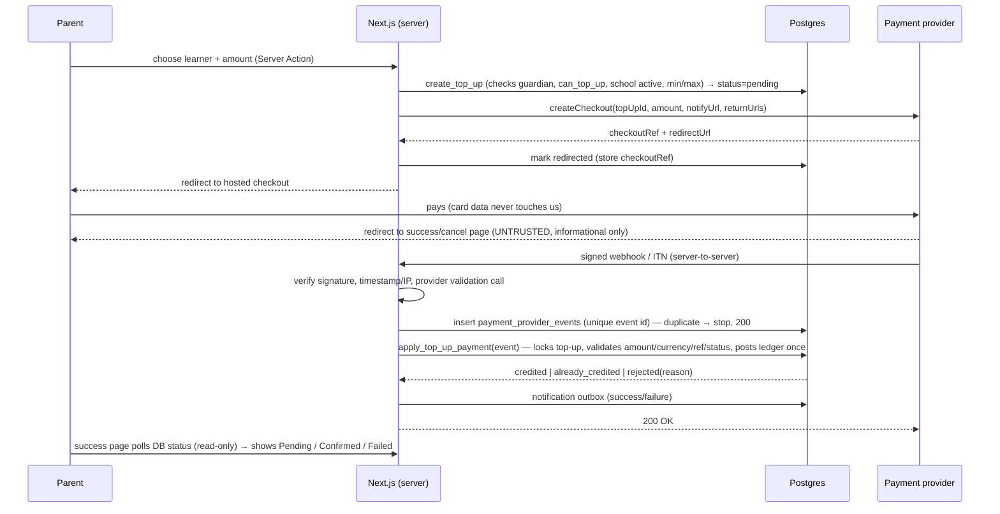

# Payments and Ledger

> Status: **Proposed – awaiting approval (pre-Phase 1)**
> Provider research performed **2026-10-25** from the providers' public developer documentation. Items marked **[VERIFY]** were not confirmed from primary documentation in that research and must be confirmed against the live docs / your merchant account before implementation (Phase 9 starts with a verification spike).

---

## 1. Principles

1. Money is **integer cents** (`bigint`). No floats. Rand formatting happens only at display.
2. Every movement of value is a **balanced, immutable double-entry ledger transaction**.
3. A wallet balance is a **record of entitlement** held by the platform's database. It is **not** proof that the platform (or anyone) holds that cash. Where the cash sits is a separate, configurable question (§2).
4. All money operations are **atomic, idempotent and server-side**. The browser cannot credit, debit or mark anything paid.
5. Corrections are **new reversing/adjusting entries**. Nothing financial is updated or deleted.
6. A payment is only believed when it is **verified server-to-server** (signature + amount + currency + reference + status), and is applied **exactly once**.
7. Nothing in the UI shows success until the database transaction has committed and the server has said so.

---

## 2. Custody and settlement model (legal dependency)

The brief requires the platform to distinguish *money actually held* from *wallet balances recorded*. We do not assume that the SaaS operator may lawfully receive and hold pooled customer funds. Holding prepaid funds for others can attract payment-system, deposit-taking, consumer-protection and tax obligations in South Africa. **This must be reviewed by a South African attorney before any live payment (decision D-11).**

`school_settings.custody_model` makes the arrangement explicit and configurable:

| Model | Who receives parent payments | Platform role | Status in this project |
|---|---|---|---|
| `school_merchant` **(recommended default)** | Each school's **own** merchant account with the payment provider; settlement goes directly to the school's bank account | Software + ledger operator only. Never touches the funds | Implemented first |
| `provider_split` | Platform merchant account takes the payment; provider splits to the school automatically | Platform account is in the money path (briefly). Legal view needed. Depends on provider split capabilities **[VERIFY]** | Architecture allows; **not enabled** |
| `platform_pooled` | Platform's account holds pooled funds and pays schools out | Holds customer funds | **Blocked.** Cannot be switched on without a recorded legal-approval flag and super-admin action; not built in v1 |

Consequences for design:
- Payment credentials are **per school** (`school_payment_credentials`, envelope-encrypted, service-role only). Webhook URLs are per school: `/api/webhooks/<provider>/<schoolId>` so the correct secret/passphrase is used to verify each event.
- The ledger separates: `provider_clearing` (money the provider owes/has settled to the school), `wallet_liability` (what the school owes learners/parents in spendable balance) and `school_sales` (value consumed at the tuck shop). Reports therefore show **top-ups ≠ sales ≠ settled funds**.
- Subscription fees the schools pay the platform are a *separate revenue stream* (`subscription_invoices`), never mixed into wallet ledgers.
- Open policy questions that need a school/legal decision: refund of unspent balance when a learner leaves; expiry/dormancy of balances; who bears provider fees; chargeback liability.

---

## 3. Payment provider evaluation

### 3.1 Findings (from public developer documentation, 2026-10-25)

| Capability | PayFast | Yoco (Checkout API) |
|---|---|---|
| ZAR hosted checkout | Yes (redirect form to `payfast.co.za/eng/process`; sandbox at `sandbox.payfast.co.za`) | Yes — server creates checkout via `POST https://payments.yoco.com/api/checkouts` (Bearer secret key, amount in cents, `ZAR` only), customer redirected to `redirectUrl` |
| Server-to-server confirmation | **ITN** (Instant Transaction Notification) to `notify_url`. Documented validation steps: verify signature, validate with PayFast's server (`/eng/query/validate`), return HTTP 200 **[VERIFY exact ITN signature field-ordering, source-IP allow-list and amount checks in Phase 9 spike]** | **Webhooks** with `webhook-id`, `webhook-timestamp`, `webhook-signature` headers: HMAC-SHA256 (base64) over `id.timestamp.rawBody` using the `whsec_…` secret; timestamp tolerance recommended ≤ 3 min; constant-time compare. Event types documented: `payment.succeeded`, `refund.succeeded`, `refund.failed` |
| Failed/cancelled payment notification | ITN carries payment status (`COMPLETE`, etc.) **[VERIFY failed/cancelled coverage]** | **No `payment.failed` webhook is documented** – failures/cancellations are only known via the browser redirect (untrusted) or by polling. Our recovery job expires abandoned checkouts |
| Tokenised card / stored payment method | **Yes** – tokenisation (`subscription_type=2`) returns a token in the ITN; ad-hoc charges via `POST /subscriptions/{token}/adhoc` (amount in cents, optional `m_payment_id`, ITN toggle). Must be enabled on the merchant account **[VERIFY enablement, and that ad-hoc charges don't need a CVV from the customer for our use-case]** | Not documented in the Checkout API → **auto top-up cannot be built on Yoco as documented** |
| Recurring billing / subscriptions | Yes (subscription API) | Not documented |
| Refund API | Yes – `GET /refunds/query/{pf_payment_id}`, `POST /refunds/{pf_payment_id}` (API signature = MD5 of sorted params + passphrase) **[VERIFY limits/eligibility by payment method]** | Yes – `POST /api/checkouts/{id}/refund` (full or partial amount, idempotency key supported); result confirmed by `refund.succeeded/failed` webhook; **only for checkouts created with live keys** |
| Idempotency support | `m_payment_id` (our reference) | `Idempotency-Key` header on create/refund |
| Split payments / marketplace | Split Payments exist; documentation states only **one receiving merchant** per split transaction **[VERIFY commercial/legal fit]** | Not documented |
| Sandbox | Yes | Yes (test keys). **Live keys require domain verification** in the Yoco app |
| Merchant model | Merchant ID + key + passphrase per merchant | Secret key + webhook secret per merchant; domain verification (max 3 domains per business) |

Sources: PayFast developer docs (`developers.payfast.co.za`), Yoco developer docs (`developer.yoco.com`, `yoco.docs.buildwithfern.com`), Yoco help-centre "Yoco Checkout API" article.

### 3.2 Recommendation

**Implement PayFast first**, because it is the only one of the two with *documented* tokenisation + ad-hoc charging (needed for optional automatic top-ups) and a documented split capability should the legal model later require it. Keep the provider abstraction clean so **Yoco** can be added as a second adapter (its webhook security model is simpler and stronger; it lacks documented recurring support).

If PayFast is chosen but the school's merchant account does not have tokenisation enabled, automatic top-ups are **not offered**; the product falls back to low-balance notifications with one-click manual top-up, exactly as the brief requires. We will never simulate a successful automatic charge.

This is decision **D-2**; if you already have a merchant account with one of them for the pilot school, that should weigh heavily.

### 3.3 Provider abstraction

```ts
// lib/payments/provider.ts
export interface PaymentProvider {
  readonly id: 'payfast' | 'yoco';
  readonly capabilities: {
    hostedCheckout: true;
    tokenisedRecurring: boolean;   // true only when verified + enabled for the merchant
    refunds: boolean;
    splitPayments: boolean;
  };

  createCheckout(input: {
    topUpId: string;            // our reference (m_payment_id / metadata)
    amountCents: number;
    currency: 'ZAR';
    returnUrls: { success: string; cancel: string; failure: string };
    notifyUrl: string;
    payer: { firstName: string; lastName: string; email: string };
    itemName: string;           // generic, no child's full name
    idempotencyKey: string;
    tokenise?: boolean;
  }, creds: ProviderCredentials): Promise<{ checkoutRef: string; redirectUrl: string }>;

  // Pure + side-effect free: verifies authenticity of a raw webhook.
  verifyWebhook(req: { rawBody: string; headers: Headers; sourceIp?: string }, creds: ProviderCredentials)
    : Promise<VerifiedProviderEvent | { valid: false; reason: string }>;

  // Server-side confirmation / reconciliation (query provider for the truth).
  fetchPaymentStatus(ref: string, creds: ProviderCredentials): Promise<ProviderPaymentStatus>;

  refund?(input: { paymentRef: string; amountCents: number; idempotencyKey: string }, creds): Promise<ProviderRefundResult>;
  chargeToken?(input: { token: string; amountCents: number; reference: string; idempotencyKey: string }, creds): Promise<ProviderChargeResult>;
}
```

`VerifiedProviderEvent` is a normalised type: `{ provider, eventId, kind: 'payment_succeeded' | 'payment_failed' | 'payment_cancelled' | 'refund_succeeded' | 'refund_failed', providerPaymentId, merchantReference, amountCents, currency, feeCents?, rawPayload }`. Adapters never touch the database.

---

## 4. Accounting model

### 4.1 Accounts (per school, plus wallet accounts)

| Account type | Nature | Meaning |
|---|---|---|
| `provider_clearing` | Asset (debit-normal) | Funds the provider has collected for the school and not yet settled |
| `settled_funds` | Asset (debit-normal) | Funds settled to the school's bank (informational mirror of `provider_settlements`) |
| `wallet_liability` (one per wallet) | Liability (credit-normal) | Spendable balance owed to the learner/parent |
| `school_sales` | Revenue/payable (credit-normal) | Value consumed at the tuck shop |
| `provider_fees` | Expense (debit-normal) | Provider fees (where borne by the school) |
| `adjustments` | Equity-like (either) | Counter-account for administrative adjustments, with mandatory reason codes |
| `suspense` | Either | Unresolved items (chargebacks > available balance, unmatched payments) — must be cleared by an authorised user |
| `platform_fees` | Revenue | Reserved for any future per-transaction platform fee (not enabled) |

> `settled_funds` is added to the `account_type` enum in the schema migration (it is noted here so DATABASE_SCHEMA §7 stays in sync during Phase 2).

### 4.2 Journal examples (all amounts in cents)

| Event | Debit | Credit |
|---|---|---|
| Top-up R500 succeeds | `provider_clearing` 50 000 | `wallet_liability` 50 000 |
| Provider fee R7.50 on that top-up *(if recorded)* | `provider_fees` 750 | `provider_clearing` 750 |
| Purchase R47 (chips 12 + juice 10 + sandwich 25) | `wallet_liability` 4 700 | `school_sales` 4 700 |
| Purchase refund R10 (juice) | `school_sales` 1 000 | `wallet_liability` 1 000 |
| Provider settles to school bank | `settled_funds` X | `provider_clearing` X |
| Top-up reversed (money returned to parent's card) | `wallet_liability` N | `provider_clearing` N |
| Admin credit adjustment R20 | `adjustments` 2 000 | `wallet_liability` 2 000 |
| Admin debit adjustment R20 | `wallet_liability` 2 000 | `adjustments` 2 000 |
| Reversal of any transaction T | mirrors T with sides swapped; `reverses_transaction_id = T` | |

Worked example from the brief: top-up R500 → wallet 50 000; purchase R47 → wallet 45 300 (R453.00). Ledger: provider_clearing +50 000, school_sales +4 700, wallet_liability = 45 300; debits = credits at every transaction.

### 4.3 Invariants (each has an automated test)

1. Each ledger transaction: `Σ debit = Σ credit`; ≥ 2 entries; all amounts > 0; all accounts in the same school.
2. Ledger rows are never updated or deleted.
3. `wallets.balance_cents = Σ credits − Σ debits` on its `wallet_liability` account, always, and `≥ 0`.
4. `Σ wallet_liability = Σ top-ups − Σ purchases + Σ refunds − Σ reversals ± Σ adjustments` (reconciliation identity per school).
5. A given `(school_id, idempotency_key)` produces at most one ledger transaction.
6. A transaction can be reversed at most once.
7. Cross-school postings are impossible (composite FKs).

### 4.4 Reconciliation

`run_reconciliation()` produces `reconciliation_records` for:
- **Wallet vs ledger:** recomputed balance vs `balance_cents`.
- **Ledger balance:** global and per-school Σdebits = Σcredits.
- **Provider vs top-ups:** succeeded top-ups vs provider events/ITN data and (where supported) provider transaction queries.
- **Settlement:** `provider_clearing` balance vs imported `provider_settlements` (expected − settled − fees).

Non-zero variance raises an alert and an item in the super-admin/school reconciliation views; fixing it requires an adjusting entry (never an edit).

---

## 5. Idempotency and concurrency model

- **Idempotency keys**
  - Purchases: client-generated UUID per checkout attempt, stored with a `request_hash` (canonical hash of items + credential reference). Same key + same hash → returns the original result; same key + different hash → error.
  - Top-ups: `idempotency_key` on creation; the credit posting key is deterministic: `topup:{top_up_id}:credit`.
  - Webhooks: `(provider, provider_event_id)` unique in `payment_provider_events`; the credit is *also* protected by the deterministic ledger key — two independent guards.
  - Provider calls: pass the provider's idempotency mechanism where it exists (Yoco `Idempotency-Key`; PayFast `m_payment_id`).
- **Locking order** (prevents deadlocks): `nfc_cards` row (read lock) → `wallets` row `FOR UPDATE` → `products` rows `FOR UPDATE` ordered by id → insert records → update projections.
- **Isolation:** default READ COMMITTED with explicit row locks is sufficient because every critical section starts by locking the wallet; the functions re-read state **after** acquiring the lock.
- **No client arithmetic:** the server recomputes line totals from DB prices; any client-sent totals/prices are ignored (or rejected if they differ, to detect stale baskets).

---

## 6. POS purchase flow

### 6.1 Sequence

1. Cashier builds basket (barcode scan / touch / search). The client holds product ids + quantities only.
2. **Checkout** pressed → client generates `idempotency_key`, shows "Please tap your school card."
3. Reader abstraction returns a **credential proof** (see NFC_INTEGRATION). The server verifies the proof cryptographically (Next.js server) and resolves it to a `credential_reference`.
4. `pos_preview_checkout` (read-only): returns learner first name + last initial, grade, wallet balance, total, and each check's pass/fail with a reason code. **Non-binding** – state can change before confirmation.
5. Cashier presses **Confirm** (single large button, disabled after first press).
6. `pos_checkout` executes atomically (6.2). Only after it commits does the POS show **PAYMENT SUCCESSFUL – Amount paid – Remaining balance**.
7. Receipt is generated from the stored purchase (receipt number, items, totals, balance after, time, cashier). Printing is optional; on-screen receipt always.

### 6.2 `pos_checkout` algorithm (single database transaction)

```
INPUT: actor_id, school_id, idempotency_key, credential_reference (already verified by server),
       items[{product_id, qty}], pos_device_id?, reader_device_id?, shift_id?, override?

0.  If purchase exists for (school_id, idempotency_key):
        if request_hash matches → return stored result (idempotent replay)
        else → raise IDEMPOTENCY_CONFLICT
1.  Authorise actor: active role_assignment (cashier or school_admin) for school_id with POS permission; profile active.
2.  School status = 'active' (else SCHOOL_SUSPENDED). Open shift if required.
3.  Card: SELECT … FROM nfc_cards WHERE credential_reference = $ref → must exist, same school,
        status = 'active', not expired, scheme allowed by school_settings/environment (UID-only/simulated gated).
4.  Learner active; wallet: SELECT … FOR UPDATE; wallet.status = 'active'.
5.  Products: SELECT … WHERE id = ANY($ids) AND school_id = $school ORDER BY id FOR UPDATE;
        all exist, is_active, not archived; unit prices come from here, qty > 0, limits on qty/line count.
6.  Stock: for track_stock products, stock_quantity >= qty else INSUFFICIENT_STOCK.
7.  total = Σ(price_cents × qty)  (integer math; overflow-checked); total > 0.
8.  Funds: wallet.balance_cents >= total else INSUFFICIENT_FUNDS.
9.  Spending limits (school timezone): spent_today + total <= daily_limit; spent_week + total <= weekly_limit
        (spent = completed purchases − refunds in window). Failing → LIMIT_EXCEEDED unless a valid authorised override.
10. Restrictions (if enabled): blocked categories/products/weekdays. Failing → RESTRICTED unless override.
        Override requires permission 'pos.override' and writes purchase_overrides + audit_logs.
11. INSERT purchases, purchase_items (snapshots).
12. INSERT ledger_transactions + 2 ledger_entries (Dr wallet_liability / Cr school_sales).
13. UPDATE wallets SET balance_cents = balance_cents − total   (CHECK >= 0 is the last line of defence).
14. UPDATE products stock + INSERT inventory_movements (type 'sale').
15. UPDATE nfc_cards.last_used_at (+ last_read_counter for SDM); INSERT card_events(read_ok).
16. INSERT notification/outbox rows (purchase notice if enabled, low-balance if threshold crossed).
17. INSERT audit_logs (overrides only; ordinary sales are in purchases).
COMMIT → return {purchase_id, receipt_number, total, balance_after, items}.

ON ANY ERROR: whole transaction rolls back (no partial deduction).
Declines are recorded afterwards in purchase_attempts by a separate statement (autonomous, outcome != success).
```

Failure codes (stable, mapped to cashier-friendly messages): `UNKNOWN_CARD`, `CARD_NOT_ACTIVE` (frozen/lost/stolen/replaced/deactivated), `CARD_EXPIRED`, `WALLET_FROZEN`, `INSUFFICIENT_FUNDS`, `LIMIT_EXCEEDED`, `RESTRICTED_PRODUCT`, `PRODUCT_UNAVAILABLE`, `INSUFFICIENT_STOCK`, `SCHOOL_SUSPENDED`, `NOT_AUTHORISED`, `SHIFT_REQUIRED`, `IDEMPOTENCY_CONFLICT`, `REPLAY_DETECTED`, `INVALID_CREDENTIAL`, `TIMEOUT_UNKNOWN`, `SYSTEM_ERROR`.

### 6.3 Unreliable network handling

- Success is shown **only** from a committed server response.
- If the request times out/disconnects → "Outcome unknown – checking…" → `pos_get_purchase_status(idempotency_key)`. Result is `completed` (show success), `not_found` (safe to retry with **the same key**, or cancel), or `error`.
- Retrying with the same key is always safe. Creating a new key is only offered after the status check confirms no purchase exists.
- The basket survives reconnects; no card data is stored client-side.

---

## 7. Online top-up flow



### 7.1 Webhook processing rules (`apply_top_up_payment`)

1. **Authenticity first**: signature (and for PayFast also the server validation call and allowed source IPs; for Yoco the timestamp window) using **the credentials of the school in the URL**. Failure → log in `payment_provider_events` with `signature_valid=false`, respond 4xx, do nothing else.
2. Insert the event with unique `(provider, provider_event_id)`; conflict → `ignored_duplicate`, return 200 (provider may retry safely).
3. Locate the top-up by **our reference** (`m_payment_id` / checkout metadata); it must belong to the same school as the webhook URL and have `status in (pending, redirected)`.
4. Validate: `amount_cents` equals the top-up amount exactly; `currency = 'ZAR'`; provider status is the success status; merchant id matches.
5. In one transaction: `SELECT … FOR UPDATE` the top-up; if already `succeeded` → no-op; else post ledger `Dr provider_clearing / Cr wallet_liability` with key `topup:{id}:credit`, update wallet projection and top-up status, store `provider_payment_id` and fee. Unique `(provider, provider_payment_id)` prevents attaching one payment to two top-ups.
6. Amount mismatch / unknown reference / wrong school / wallet closed → `rejected`, **no credit**, alert + `suspense` handling for manual review.
7. Failure/cancel events set `failed/cancelled` and notify the parent; a later (late) success for a failed top-up is **re-validated and may still credit** because the provider is the authority on whether money moved.
8. Never credit because a user hit a success URL; that page only reads server state.

### 7.2 Recovery

- Cron `reconcile_pending_top_ups`: for top-ups pending > N minutes, call `fetchPaymentStatus`; apply via the **same** `apply_top_up_payment` path; expire after the checkout lifetime. This covers lost webhooks and (for Yoco) the absence of failure webhooks.
- Provider outage at creation → top-up marked `failed` (no charge possible), user told to retry.

---

## 8. Automatic top-ups (conditional)

Enabled **only if** (a) the provider adapter reports `tokenisedRecurring = true`, (b) the school's merchant account has the feature, and (c) the parent has given explicit, recorded consent.

- Opt-in screen states: threshold, top-up amount, **maximum amount per charge**, **monthly cap**, which card (masked), how to disable; stores a `consent_records` row (purpose, version, timestamp).
- Token is obtained through the hosted checkout flow (card data never touches us); stored encrypted (`provider_token_ref`).
- Trigger: after a ledger commit that takes balance below threshold, an outbox row is created; a worker re-checks balance, caps, `failure_count`, and "no pending auto top-up for this wallet" (unique partial index) before charging with an idempotency key such as `auto:{wallet_id}:{yyyymmdd-hhmm-bucket}`.
- Result is *still* confirmed via the verified ITN/webhook path (same `apply_top_up_payment`). A synchronous API "success" alone does not credit.
- Failure: increment `failure_count`, notify parent (essential notification), auto-disable after N failures; no retries storm.
- Otherwise: low-balance notification + one-click manual top-up deep link. No simulated automatic payments, ever.

---

## 9. Refunds, reversals, adjustments, disputes

| Case | Flow | Ledger |
|---|---|---|
| **Purchase refund** (cashier/admin) | Cashier *requests* with reason; ≤ threshold may be self-approved if permitted, otherwise a school_admin approves. Function locks the purchase, checks remaining refundable quantity/amount, optionally restocks | Dr `school_sales` / Cr `wallet_liability`; `purchase_items.refunded_quantity` and purchase status updated; inventory `refund_return` if restocked. Idempotency key per refund request prevents duplicates |
| **Top-up refund to parent's card** (provider refund) | Admin-initiated through provider API; allowed only up to **unspent** wallet balance; confirmed by provider event | Dr `wallet_liability` / Cr `provider_clearing` after provider confirms (`reversed`) |
| **Chargeback / payment reversal by provider** | Provider event → top-up marked `reversed`; wallet debited up to available balance; remainder booked to `suspense` for school/finance resolution | Dr `wallet_liability` (≤ balance) + Dr `suspense` / Cr `provider_clearing` |
| **Administrative adjustment** | Reason code + notes mandatory; dual-control above threshold; audited | via `adjustments` account |
| **Learner leaves with balance** | Operational policy (D-11); executed as a provider refund or adjustment with approval | as above |

Rules: reversing entries link via `reverses_transaction_id` (single reversal enforced); every refund/adjustment triggers a parent notification where appropriate; none can drive a wallet negative.

---

## 10. Reports and "what counts as revenue"

| Metric | Definition (source) |
|---|---|
| **Sales** | Σ `school_sales` credits − refunds (from `purchases`) |
| **Top-ups received** | Σ succeeded `wallet_top_ups` (not revenue) |
| **Wallet liability** | Σ `wallets.balance_cents` (reconciled to ledger) |
| **Refunds** | Σ completed purchase refunds + provider refunds |
| **Settled funds** | Σ imported `provider_settlements.net_cents` |
| **Provider fees** | Σ `provider_fees` |
| **Platform subscription revenue** | Σ paid `subscription_invoices` (**never** gross payment volume) |

---

## 11. Security specifics for payments

- Credentials only in environment variables / encrypted `school_payment_credentials`; never sent to the client, never logged. Secret/merchant keys appear only in files marked `server-only`.
- Webhook endpoints: read the **raw body** (needed for signature), constant-time comparison, replay window, per-IP and per-school rate limits, body size limit, always return generic responses; no stack traces.
- Hosted checkout only; the platform never receives PAN/CVV (keeps PCI scope minimal, SAQ A-style). Final PCI scoping to be confirmed with the provider.
- Checkout item names are generic ("Tuck shop wallet top-up") — no child's full name sent to the provider.
- Test and live credentials are separate and the environment flag + `payments_enabled=false` default prevent accidental live charges; going live is an explicit, audited super-admin action after the production-readiness gates.

---

## 12. Financial integrity test matrix (Phase 5/9/12)

| Scenario | Expected |
|---|---|
| Two concurrent purchases that together exceed balance | Exactly one succeeds; balance ≥ 0 |
| Same idempotency key sent 20× in parallel | One purchase, one ledger transaction, identical responses |
| Same key, different basket | `IDEMPOTENCY_CONFLICT` |
| Webhook delivered 10× (also in parallel) | One credit |
| Webhook with wrong amount / currency / reference / bad signature | Rejected, no credit |
| Success URL visited without webhook | No credit |
| Failure injected after wallet update (rollback) | No ledger, no purchase, no stock change, no balance change |
| Refund requested twice / over-refund / concurrent | Single refund; never exceeds purchase |
| Ledger tamper (UPDATE/DELETE) via any role | Rejected |
| Unbalanced ledger insert | Fails at commit |
| Cross-school wallet/product in a purchase | Rejected |
| Suspended school purchase/top-up | Rejected; history intact |
| Spending limit boundary at school-day rollover (timezone) | Correct window |
| Browser/PostgREST direct write to wallets/ledger/purchases | Denied |
| Reconciliation after random operation fuzzing | Zero variance |
